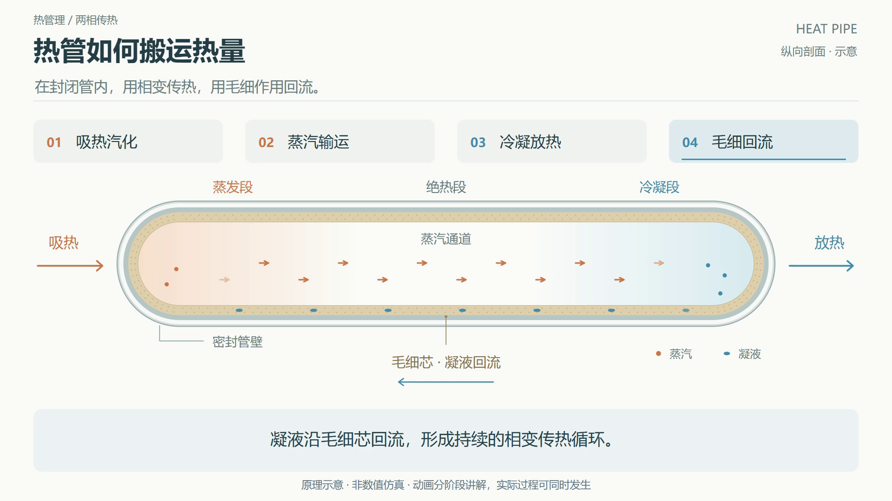

# Scientific Animation Studio · 原理机制动画工坊

将资料中的原理制作成精细、可编辑的二维机制动画。根据机制设计画面和运动，交付离线交互 HTML、H.264 MP4，或两者。



## 安装到 Codex

下载 ZIP 并解压，将完整 `scientific-animation-studio` 文件夹放入你的 Codex skills 目录：

- Windows：`%USERPROFILE%\.codex\skills\`
- macOS / Linux：`~/.codex/skills/`
- 自定义 `CODEX_HOME` 时：该目录下的 `skills/`。

开始新对话，让 Codex 重新发现 skill。安装包不包含本机运行环境或账号配置。

## 使用

```text
使用 $scientific-animation-studio，把这段材料的工作原理做成精细的动画。
观众是大学生，20 秒，中文。先让我选择 HTML、MP4 或两者。
```

也可以直接指定：

```text
使用 $scientific-animation-studio，将这段反应机理做成 30 秒 MP4。
实体颜色保持一致，关键中间态停留两秒，说明箭头与字幕不要遮挡运动。
```

技能会拆解实体、状态、条件和因果关系，选择剖面输运、反应/结合、反馈回路、状态转换等表达，生成分镜与 JSON，细化矢量几何和运动，然后检查关键帧及完整时间轴。视频导出后完整解码验证。临时截图和缓存在验收后清理。

适用于能用二维示意清楚解释的科学、工程、生物化学、算法与系统机制。复杂空间关系可能需要其他 3D 工具；真实仿真、写实视频与精确流场求解不由 SVG 播放器提供。最终质量取决于资料、机制拆解和视觉迭代，不能保证任意输入无需修改即可达到所有人的审美要求。

## 成品与制作环境

读者只需浏览器或普通播放器，HTML 可离线打开，无 CDN 或远程字体。HTML 支持暂停、进度拖动、调速、键盘与手机放大。不同语言由 Agent 在文字和必要控件中本地化。

制作 HTML：Python 3.10+，只用标准库。

```sh
python -B scripts/build_animation.py --spec examples/heat-pipe/animation.json --output output/heat-pipe.html
```

制作 MP4：Node.js 20+、Playwright、可用 Chromium/Chrome/Edge，以及支持 libx264 的 FFmpeg。优先使用现有环境；需要安装 Playwright 时，可将其装到技能私有目录：

```sh
npm install --prefix .runtime playwright
```

运行时可使用现有浏览器路径；若未安装浏览器，可按 Playwright 的官方安装方式安装 Chromium。FFmpeg 从可信的官方渠道自行安装或复用已有版本，不随技能包分发。

```sh
node scripts/audit_animation.mjs --html output/heat-pipe.html --output output/audit --browser "/path/to/browser"
node scripts/render_mp4.mjs --html output/heat-pipe.html --output output/heat-pipe.mp4 --browser "/path/to/browser" --ffmpeg "/path/to/ffmpeg" --fps 24 --scale 1.5
```

Windows 的路径使用引号即可。外部 Playwright 包可用 `--playwright` 指定其绝对路径。1280×720 矢量画布以 `--scale 1.5` 直接渲染成 1920×1080；画布布局不变。已有输出拒绝覆盖，修改时使用新文件名。

## 示例与质量检查

- [热管剖面动画](examples/heat-pipe/animation.html)：同心边界、毛细芯纹理、区域裁切、蒸汽与凝液独立通道。[MP4](examples/heat-pipe/animation.mp4)
- [抽象状态转换](examples/state-transfer/animation.html)：条件触发、同一状态标记、结束停留。
- [抽象可逆结合](examples/reversible-binding/animation.html)：对象身份保持、结合态与解离。

后两例仅演示完整定义的抽象规则，不代表具体化学或算法事实。真实主题必须用源资料替换。本包所有示例保留 JSON 与分镜，HTML 为 JSON 的生成结果。

机器检查覆盖越界、可见标签间距、运动与标签交叠、声明碰撞组内的相交、脚本错误和联网依赖。检查基于包围盒，不能代替人工检查曲线接缝、科学正确性或审美。技术检查通过后仍需打开关键帧放大审查。

```sh
python -B -m unittest discover -s tests
python -B scripts/package_skill.py --root . --output ../scientific-animation-studio.zip
```

设计原则见 [视觉与运动](references/visual-design.md)，领域选择见 [机制表达](references/mechanism-patterns.md)，格式与命令见 [制作规范](references/production.md)。

## 许可

原创代码和矢量示例采用 MIT 许可。热管机制的事实来源在示例分镜中记录，来源内容与第三方工具各遵循其自身许可；未复制 NASA 图片，也未打包字体、浏览器或 FFmpeg。
